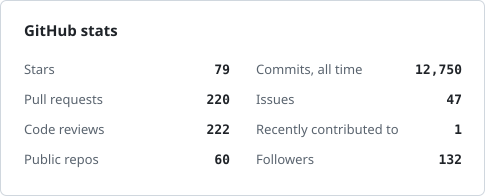
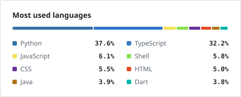
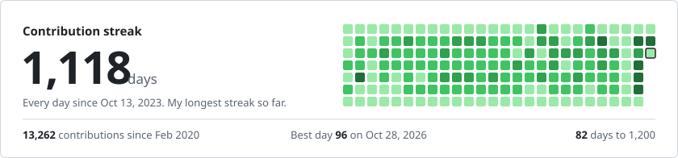

  

  
  

## 💫 About me

- 🔭 I'm currently working on improving my skills
- 🌱 I'm currently learning DevOps
- 💬 Ask me about TypeScript

## 🌐 Socials

  
  
  
  
  

## 💻 Tech stack

**Languages** 

**Frameworks and runtimes** 

**Databases** 

**DevOps, cloud and tools** 

**ML and design** 

**Also** 

## 📊 GitHub stats

  <picture>
    <source media="(prefers-color-scheme: dark)" srcset="./assets/stats-dark.svg" />
    
  </picture>
  <picture>
    <source media="(prefers-color-scheme: dark)" srcset="./assets/langs-dark.svg" />
    
  </picture>

  <picture>
    <source media="(prefers-color-scheme: dark)" srcset="./assets/streak-dark.svg" />
    
  </picture>

  <picture>
    <source media="(prefers-color-scheme: dark)" srcset="https://raw.githubusercontent.com/thenishantsapkota/thenishantsapkota/output/snake-dark.svg" />
    
  </picture>

Stats, streak and snake are rebuilt every day by <a href=".github/workflows/update_readme.yml">this repo's own workflow</a>.

## 🎵 Currently listening to

#### Current Date: 2026-11-02 23:25:30

<!-- Proudly created with the help of prajita -->
