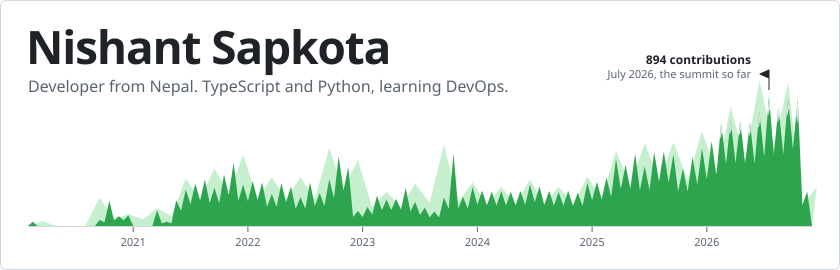

<picture>
  <source media="(prefers-color-scheme: dark)" srcset="./assets/hero-dark.svg" />
  
</picture>

Each peak is one month of my contributions since February 2020. Redrawn every day.

 

## About me

- I'm currently working on improving my skills
- I'm currently learning DevOps
- Ask me about TypeScript

## Socials

    

## Tech stack

**Languages** 

**Frameworks and runtimes** 

**Databases** 

**DevOps, cloud and tools** 

**ML and data** 

**Design** 

## GitHub

  <picture>
    <source media="(prefers-color-scheme: dark)" srcset="./assets/stats-dark.svg" />
    
  </picture>
  <picture>
    <source media="(prefers-color-scheme: dark)" srcset="./assets/langs-dark.svg" />
    
  </picture>

  <picture>
    <source media="(prefers-color-scheme: dark)" srcset="./assets/streak-dark.svg" />
    
  </picture>

  <picture>
    <source media="(prefers-color-scheme: dark)" srcset="./assets/snake-dark.svg" />
    
  </picture>

Stats, streak and snake are rebuilt every day by <a href=".github/workflows/update_readme.yml">this repo's own workflow</a>.

## Listening

#### Current Date: 2026-11-02 23:27:05

<!-- Proudly created with the help of prajita -->
